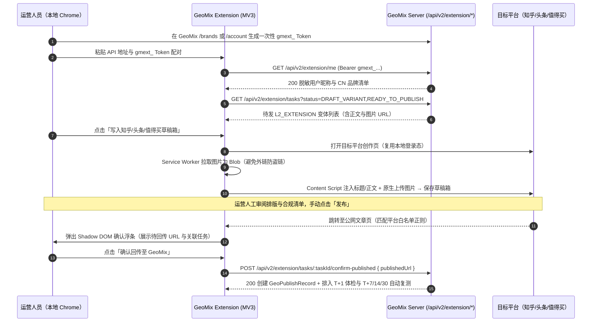

# GeoMix Extension MVP 需求规格与技术架构设计（L2 本地草稿箱分发与 URL 回传）

> **仓库定位**：GeoMix v2.2 独立伴生 Chrome 扩展（Manifest V3），与主仓 [`yexiu700/geomix`](https://github.com/yexiu700/geomix) 通过 Bridge v1 契约解耦协同  
> **主仓关联**：总 Epic [`yexiu700/geomix#375`](https://github.com/yexiu700/geomix/issues/375) · 共享契约 [`#367`](https://github.com/yexiu700/geomix/issues/367) · 桥接后端 [`#371`](https://github.com/yexiu700/geomix/issues/371) · 控制台配对与队列 [`#373`](https://github.com/yexiu700/geomix/issues/373)  
> **开发红线**：详见 [AGENTS.md](../AGENTS.md)

---

## 一、背景与目标

国内 GEO 权重最高的三类半封闭内容社区（**知乎、今日头条、什么值得买**）均不向第三方 SaaS 开放官方发文 API。在 GeoMix v2.1 中，运营人员需要手工复制文本、逐张下载再上传图片、发布后再手动复制文章链接贴回 GeoMix，导致操作繁琐且回填 URL 漏填率高，进而阻断 T+1 收录体检与 T+7/14/30 自动复测归因闭环。

**GeoMix Extension MVP（L2 本地登录态助手）** 借鉴开源多平台草稿分发架构理念（纯本地浏览器态、零服务端 Cookie），实现以下极简 3 步闭环：

1. **拉取待发变体**：在 Chrome 扩展中绑定 GeoMix 最小权限配对 Token，一键查看当前品牌 CN 市场下的待发 `L2_EXTENSION` 任务（知乎 / 今日头条 / 什么值得买）。
2. **一键写入草稿箱（含图片防盗链中转）**：点击「写入草稿箱」，扩展自动打开或复用目标平台编辑页，在用户本地已登录态下注入标题与格式化正文，并将文章配图通过本地 `Blob/File` 中转上传至平台原生图床，保存为草稿箱（**绝不自动点击最终发布**）。
3. **自动捕获公网 URL 回传归因**：用户在平台原生编辑器肉眼审阅并手动点击「发布」后，扩展监听跳转至已发布文章页，弹出 Shadow DOM 确认浮条，点击一次即可把公网 URL 回传 GeoMix，自动创建 `GeoPublishRecord` 并启动 T+1 抓取体检与 T+7/14/30 定时复测。

### MVP 范围界定

| 纳入 MVP 范围                                                                          | 明确不纳入（留后续迭代）                               |
| :------------------------------------------------------------------------------------- | :----------------------------------------------------- |
| Manifest V3 Chrome 扩展（Chrome / Edge Chromium）                                      | Firefox / Safari 独立打包                              |
| 3 个国内高权平台：**知乎（专栏/回答）、今日头条（文章）、什么值得买（好文/社区投稿）** | 小红书、百家号、微博、B 站专栏（留 MVP+1）             |
| 最小权限 `gmext_` Token 配对与解绑                                                     | 账号密码直登或窃取控制台 Session Cookie                |
| 标题/正文注入、本地图片中转上传、保存草稿箱、发布后 URL 捕获回传                       | 全自动无人值守发帖、服务端模拟登录、定时排期自动点发布 |

---

## 二、端到端交互与安全架构



---

## 三、Bridge v1 接口契约（与 `yexiu700/geomix#371` 对齐）

所有请求携带 `Authorization: Bearer gmext_<token>` 与 `X-GeoMix-Extension-Version: <semver>`，响应遵循 GeoMix 统一 `{ code: 0, msg: 'ok', data }` 信封。

### 3.1 `GET /api/v2/extension/me`

校验配对 Token 有效性并返回最小范围上下文：

```ts
export type ExtensionMeDto = {
  nickname: string;
  tokenLabel: string;
  tokenPrefix: string;
  expiresAt: string;
  brands: Array<{
    brandId: string;
    brandName: string;
    brandMarketId: string;
    localBrandName: string;
  }>;
};
```

### 3.2 `GET /api/v2/extension/tasks`

Query 参数：`brandId?`、`provider?`（`ZHIHU_EXT | TOUTIAO_EXT | SMZDM_EXT`）、`status?`（默认 `DRAFT_VARIANT,READY_TO_PUBLISH`）。

```ts
export type ExtensionPendingTaskDto = {
  taskId: string;
  articleId: string;
  brandId: string;
  brandName: string;
  provider: "ZHIHU_EXT" | "TOUTIAO_EXT" | "SMZDM_EXT";
  channelLabel: string;
  status: "DRAFT_VARIANT" | "READY_TO_PUBLISH" | "DRAFT_PUSHED" | "PUBLISHED";
  variantTitle: string;
  variantMarkdown: string;
  variantHtml: string;
  targetUrlHint: string | null; // 如知乎高引目标问题 URL
  mediaAssets: Array<{
    url: string;
    alt: string;
    mime?: string;
  }>;
  complianceChecklist: string[];
  updatedAt: string;
};
```

### 3.3 `POST /api/v2/extension/tasks/:taskId/confirm-published`

支持 `Idempotency-Key` 请求头确保重复点击安全幂等：

```ts
export type ExtensionConfirmPublishedInput = {
  publishedUrl: string; // 必须为 https:// 且通过平台公网文章白名单校验
  publishedAt?: string;
};

export type ExtensionConfirmPublishedResult = {
  taskId: string;
  status: "PUBLISHED";
  publishRecordId: string;
  publishedUrl: string;
  crawlProbeQueued: boolean;
  retestMilestones: number[]; // 默认 [7, 14, 30]
};
```

---

## 四、统一 Adapter 引擎与 3 平台适配规范

### 4.1 `PlatformDraftAdapter` 统一接口（`src/adapters/types.ts`）

```ts
export type ExtensionProviderKey = "ZHIHU_EXT" | "TOUTIAO_EXT" | "SMZDM_EXT";

export type DraftInjectReport = {
  ok: boolean;
  stage:
    "AUTH_REQUIRED" | "EDITOR_NOT_FOUND" | "INJECTED" | "PARTIAL_MEDIA_FAILED";
  draftUrl?: string;
  uploadedImages: number;
  failedImages: number;
  message: string;
};

export interface PlatformDraftAdapter {
  readonly provider: ExtensionProviderKey;
  readonly displayName: string;
  readonly editorEntryUrl: string;
  readonly publishedUrlPatterns: readonly RegExp[];
  isLoggedInEditor(doc: Document, url: URL): boolean;
  injectDraft(
    doc: Document,
    task: ExtensionPendingTaskDto,
    uploader: LocalImageUploader,
  ): Promise<DraftInjectReport>;
  extractPublishedUrl(url: URL, doc: Document): string | null;
}
```

### 4.2 三大目标平台适配要点

| 平台           | Provider Key  | 编辑页入口                                                                | 注入策略与难点处理                                                                                                                                                                   | 公网 URL 捕获白名单                                                                         |
| :------------- | :------------ | :------------------------------------------------------------------------ | :----------------------------------------------------------------------------------------------------------------------------------------------------------------------------------- | :------------------------------------------------------------------------------------------ |
| **知乎**       | `ZHIHU_EXT`   | `https://zhuanlan.zhihu.com/write`（或 `targetUrlHint` 指定问题页回答框） | 适配 Draft.js / 富文本编辑器粘贴事件（`ClipboardEvent` HTML 粘贴 + 标题输入框受控 React setter 触发 `input/change`）；未登录时友好引导用户先登录知乎；保存草稿后保留编辑页供人工审阅 | `^https://zhuanlan\.zhihu\.com/p/\d+`<br>`^https://www\.zhihu\.com/question/\d+/answer/\d+` |
| **今日头条**   | `TOUTIAO_EXT` | `https://mp.toutiao.com/profile_v4/graphic/publish`                       | 适配头条号图文 ProseMirror/富文本编辑区；通过原生图片上传控件/剪贴板事件转存本地 `File` 规避外链过滤；触发「存草稿」按钮或保留未发布态                                               | `^https://www\.toutiao\.com/article/\d+`<br>`^https://www\.toutiao\.com/i\d+`               |
| **什么值得买** | `SMZDM_EXT`   | `https://post.smzdm.com/tougao/`                                          | 适配社区长文/测评投稿编辑器；保留参数对比表格与实测数据清单，逐张中转上传配图；支持「保存草稿」并提示人工核对商品卡片与披露声明                                                      | `^https://post\.smzdm\.com/p/[a-zA-Z0-9]+`                                                  |

### 4.3 图片防盗链本地中转流程

1. Service Worker 在扩展特权网络上下文拉取 `task.mediaAssets[].url`（仅允许 `https://` 且单图 ≤ 10MB、超时 15s，限制并发 ≤ 2）；
2. 将二进制转为 Base64/ArrayBuffer 传回目标 Tab 的 Content Script，构造标准 `File` 对象；
3. 通过 `DataTransfer` 合成 `paste` 事件或写入原生 `<input type="file">`，复用平台自身 CDN 图床上传，失败时记录 `failedImages` 并在浮条明示哪张图需人工补传（绝不静默丢图）。

---

## 五、权限最小化与商店合规清单

- **Manifest V3 权限**：仅 `["storage", "tabs", "activeTab", "scripting"]`；绝不申请 `cookies`、`webRequest`、`<all_urls>`。
- **Host Permissions**：
  - `https://zhuanlan.zhihu.com/*`、`https://www.zhihu.com/*`
  - `https://mp.toutiao.com/*`、`https://www.toutiao.com/*`
  - `https://post.smzdm.com/*`
  - 用户配置的 GeoMix 实例通过 `optional_host_permissions` 动态申请（按需授权，兼容私有部署域名）。
- **自动化守卫测试**：仓库内置 `tests/manifest-security.spec.ts`，CI 强制断言不存在禁用权限、不存在 `<all_urls>`、不存在自动点击「发布」按钮的代码模式。

---

## 六、分批交付路线与 GitHub Issues 映射（Batch 0 → Batch 3）

| 批次        | Issue                                                       | 目标范围                                                                                               | 依赖                 | 并发策略            |
| :---------- | :---------------------------------------------------------- | :----------------------------------------------------------------------------------------------------- | :------------------- | :------------------ |
| **Epic**    | [#7](https://github.com/yexiu700/geomix-extension/issues/7) | GeoMix Extension MVP 总追踪（知乎 / 今日头条 / 什么值得买本地草稿箱与 URL 自动回传）                   | 主仓 `#367` / `#371` | 总控                |
| **Batch 0** | [#1](https://github.com/yexiu700/geomix-extension/issues/1) | MV3 + Vite + TS + React 工程骨架、Bridge v1 SDK、`chrome.storage.local` 配对页与待发队列 Popup         | 主仓 `#367` / `#371` | 顺序优先            |
| **Batch 1** | [#2](https://github.com/yexiu700/geomix-extension/issues/2) | 统一 `PlatformDraftAdapter` 调度引擎、Service Worker 图片防盗链中转上传器、Shadow DOM URL 捕获确认浮条 | `#1`                 | 核心底座            |
| **Batch 2** | [#3](https://github.com/yexiu700/geomix-extension/issues/3) | 知乎专栏/回答本地草稿箱注入 Adapter 与公网 URL 自动捕获（含 DOM Fixture 单测）                         | `#2`                 | 与 `#4` / `#5` 并行 |
| **Batch 2** | [#4](https://github.com/yexiu700/geomix-extension/issues/4) | 今日头条图文本地草稿箱注入 Adapter 与公网 URL 自动捕获（含 DOM Fixture 单测）                          | `#2`                 | 与 `#3` / `#5` 并行 |
| **Batch 2** | [#5](https://github.com/yexiu700/geomix-extension/issues/5) | 什么值得买好文本地草稿箱注入 Adapter 与公网 URL 自动捕获（含 DOM Fixture 单测）                        | `#2`                 | 与 `#3` / `#4` 并行 |
| **Batch 3** | [#6](https://github.com/yexiu700/geomix-extension/issues/6) | Manifest 权限安全守卫、Mock Bridge 集成回归与 Chrome Web Store 打包发布清单                            | `#3`, `#4`, `#5`     | 收口发版            |
